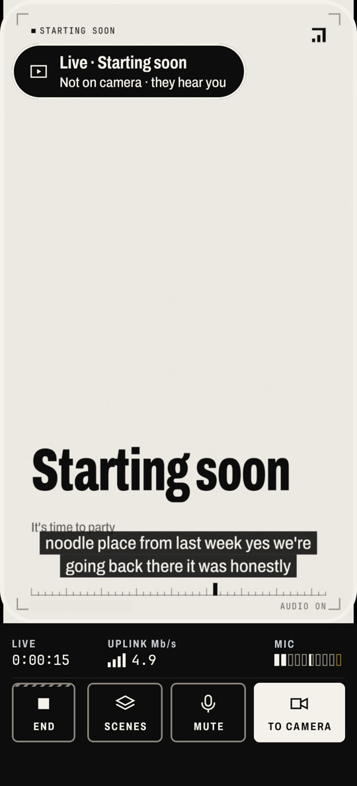
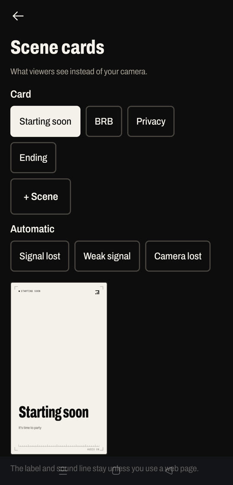
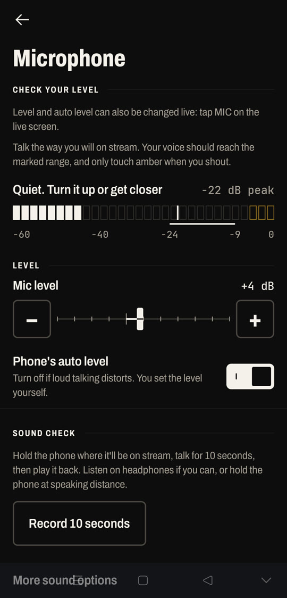

# Fullbars

Free, open-source IRL streaming to Twitch from an Android phone. Combine Wi‑Fi and mobile data, and stay on air
through dead zones with a small server you run yourself.

**[Download the APK](../../releases)** · **[Set up a BRB server](docs/guides/BRB-SERVER.md)**

<p>
  
  
  
</p>

_Screenshots from a OnePlus 12 running 0.7.0._

Website: [fullbars.app](https://fullbars.app)

## Quick start

1. **Install.** Download the APK from this repo's [Releases](../../releases) page on a phone with Android 12 or
   newer, open it, and allow installs from your browser or file manager when asked. Test builds are debug-signed,
   so moving to a future release-signed build will need an uninstall first.
2. **Sign in.** On Home, tap **Continue with Twitch**. Your browser opens twitch.tv/activate; approve Fullbars there.
   Or tap **Use a stream key instead**.
3. **Test.** **TEST · private** is selected at the bottom of Home. Tap **Start test**: you see a preview first, with
   the mic meter and your connections, and nothing is sent until you tap **START TEST**. Walk around, try a scene
   card and the mic sheet, then hold **END**. Home shows a recap of how it went.
4. **Go live.** Switch to **LIVE · public** and start.

Without a BRB server, Fullbars streams straight to Twitch over RTMPS. That works anywhere you have one good
connection. For bonding and staying live through dropouts, set up a BRB server.

## What you get

- **Live from your phone in a few taps.** Sign in with Twitch and Fullbars fetches your stream key, or paste a
  stream key yourself. Test is the default: a Test stream goes to Twitch's bandwidth test, so nobody sees it, not
  even you. When you're ready, switch to Live.
- **Combine connections.** Wi‑Fi, mobile data and a wired Ethernet adapter at once, bonded with SRTLA through your
  own BRB server. If one connection drops, the others carry the stream.
- **Stays live through dropouts.** If every connection goes, your BRB server puts your Signal lost card on stream
  after 1.5 seconds and holds the Twitch stream for up to 10 minutes. When you're back, your camera returns. When the
  connection is too weak for a moving picture, viewers see your Weak signal card and still hear you.
- **Helper phones.** A spare phone in your pocket adds its mobile data to the stream. It speaks Moblin's Moblink
  protocol, so Moblin can be the helper, and a Fullbars phone can help a Moblin streamer.
- **Preview before you go live.** Start opens the camera, the mic meter and the connections first. Nothing is sent
  until you tap GO LIVE, on your camera or on your Starting soon card.
- **DJI Pocket 3 as a wireless camera** (Settings › Camera, unofficial). Fullbars starts the Pocket's stream over
  Bluetooth and takes it in over Wi‑Fi. Other cameras that stream RTMP work too.
- **Your mic, your level.** A live level meter, a sound check you can play back, a level fader from -20 to +30 dB, a
  limiter that turns loud moments down instead of distorting, and a switch to turn off the phone's own auto level.
  Change any of it while live.
- **Scene cards.** Starting soon, BRB, Privacy and Ending, up to four scenes of your own (Lunch, Q&A…), plus
  automatic Signal lost, Weak signal and Camera lost cards. Use your own words, font, text size and colour, a
  picture, a still or GIF background, a layout and any accent colour. Add a countdown, a time-away counter, chat on
  the card, music under it, or show a web page instead of the card.
- **Alerts drawn on the phone.** Follows, subs, gift subs, bits, raids, and tips through StreamElements or
  Streamlabs. For each kind: whether it shows and the smallest worth showing, how long it stays up, its words,
  picture, colours and its own sound. Where alerts go and how big they are is yours too. You feel each one land:
  a firm buzz, and who sent it in the notice line.
- **Viewer TTS.** A "Make me talk" channel points reward that reads viewers' messages out on stream, and alerts said
  out loud ("Thank you Sam for the 500 bits!"), each kind as you choose, with or without their message. Spoken on
  the phone in one bright, dramatic voice and mixed into the stream, never through your mic. Your own blocked words,
  your Twitch blocked terms and a built-in list of the worst slurs are filtered out; mods can `!skip`, and channel
  points for anything not said go back.
- **Live captions.** What viewers hear you say, recognised on the phone (nothing is sent anywhere) and written on
  the stream. Android 13 or newer.
- **Chat with you.** Twitch chat with emotes on the live screen, and chat read aloud into your earbuds (everyone, or
  only mods, VIPs and subs). It reads only while headphones are connected, so it never goes out on stream.
- **Help from your mods.** Chat commands (`!brb`, `!live`, `!privacy`, `!starting`, `!ending`, `!scene <name>`,
  `!restartcam`, `!skip` for viewer TTS, and `!end` with a confirmation word) and a web remote they can open in a
  browser.
- **Overlays.** Chat, a line of text, an image such as a logo, and a StreamElements or Streamlabs overlay URL.
- **Also stream to.** Your BRB server can send the same stream to Kick, YouTube or any RTMP server, up to three at
  once. Your phone still uploads it only once. Test streams never go anywhere but Twitch's test.

Everything viewers see (cards, overlays, alerts, chat) is drawn by the phone before it sends, so it all works the
same with or without a BRB server.

## Going further

**Your BRB server.** A small program on a rented Linux server with Docker. It takes the phone's bonded stream and
keeps one unbroken stream going to Twitch. It doesn't re-encode video, so the smallest VPS is enough. Set it up once
with one command from this repo, then pair the app by scanning a QR code:

```bash
server/brb/deploy.sh root@YOUR_SERVER_ADDRESS
docker exec -it fullbars-brb brb pair     # on the server
```

The full guide, with firewall ports and troubleshooting: [docs/guides/BRB-SERVER.md](docs/guides/BRB-SERVER.md).
The hold time is the server's `HOLD` setting (10 minutes unless you change it).

**Helper phones.** Settings › Helper phones. On the streaming phone, tap **Add a helper phone** to show the code;
on the spare phone, go to **Use this phone as a helper** and scan it. The
helper finds the streaming phone on its hotspot (or a Wi‑Fi you share) and lends its mobile data. Helpers join a
combined stream, so they need your BRB server too.

**DJI Pocket 3.** Settings › Camera › DJI Pocket 3. This is unofficial: DJI doesn't publish an SDK for it and a
firmware update could break it.

**Also stream to.** Settings › Also stream to. Needs Combine connections and your BRB server. Each extra destination
adds your stream's bitrate to the server's upload, not the phone's.

**Mod remote.** Settings › Twitch › Mods › **Get the link**, then **Share** it with your mods. Your BRB server
serves the page, so it needs one paired. Share it only with people you trust.

**My OBS at home.** The BRB server can feed your home OBS instead of Twitch, with NOALBS switching scenes from the
server's stats: [docs/guides/HOME-OBS.md](docs/guides/HOME-OBS.md).

## How it compares

Checked in November 2026:

- Twitch's built-in Disconnect Protection shows a fixed message for up to 90 seconds. Fullbars shows your own card
  and holds for 10 minutes by default.
- Streamlabs Mobile keeps a stream up through a dropout with its Ultra plan (or a rewards-points unlock), and TVU Go
  only on its top plan. With Fullbars you pay only for your own server, if you use one.
- Moblin, whose Moblink protocol Fullbars' helper phones speak, is iOS only.
- IRL Pro and [Brix](https://f-droid.org/packages/app.brix/) also bond connections on Android with SRTLA. Fullbars
  pairs bonding with its own BRB server, which holds your card on stream through a dropout, and with helper phones
  over Moblink.

## Limits

- Android only, 12 or newer.
- Twitch first. Chat, alerts and mod commands are Twitch only. Also stream to sends the video elsewhere, but
  interaction stays on Twitch.
- Bonding, staying live through dropouts, helper phones, the mod remote and Also stream to need your own BRB
  server.
- Pre-release. Tested mainly on a OnePlus 12 as the streaming phone, with a Pixel 5 as a helper.

## Privacy

No account with us and no analytics or crash reporting. The app talks only to Twitch, to StreamElements or
Streamlabs if you add them, to web pages you add as overlays or cards, and to your own BRB server. Stream keys,
Twitch tokens and pairing details are stored encrypted on the phone, with a key kept in the Android Keystore.

## How it works

```
 phone camera, or a DJI Pocket 3 / RTMP camera over Wi-Fi
            │
            ▼
 Fullbars app: cards, overlays, alerts and chat drawn into the picture, H.264 + AAC
            │
            ├── no BRB server ──────────── RTMPS ───────────────────────────▶ Twitch
            │
            └── Combine connections: one encrypted SRT stream, split across links by srtla-kt
                   Wi-Fi ──────────┐
                   mobile data ────┤
                   Ethernet ───────┼── SRTLA ──▶ BRB server ── RTMPS ──▶ Twitch
                   helper phones ──┘             (your VPS)    └──────▶ Kick, YouTube, any RTMP
```

On the server, BELABOX's `srtla_rec` joins the links back into one SRT stream. A keeper program passes it through
while it flows; when it stalls for 1.5 seconds it loops the Signal lost card the phone encoded and uploaded, and
when the phone is back it splices the camera in again at the next keyframe. ffmpeg only remuxes (`-c copy`) to
RTMPS, so the server never decodes your video. The app talks to the server over TLS pinned to the key in the
pairing code, and the stream itself is encrypted with a passphrase from the same pairing.

## Repository layout

| Path | What | Licence |
|---|---|---|
| [`android/`](android/README.md) | The app. `:app` (Compose UI, foreground services, helper phones, DJI Pocket 3), `:engine` (capture, compositing, encoding, RTMP and bonded SRT outputs), `:twitch` (sign-in, chat, EventSub alerts, mod commands) | GPL-3.0-or-later |
| [`srtla-kt/`](srtla-kt/README.md) | SRTLA sender library for the JVM and Android, plus a desktop CLI | Apache-2.0 |
| [`server/`](server/README.md) | The BRB server: `brb/` is the Docker image and `deploy.sh`, `stay-live/` is the Go source | Apache-2.0 |
| [`docs/guides/`](docs/guides/) | Setting up the BRB server, and using OBS at home | |

The Kotlin package is `app.irlsupreme`, the project's earlier working name.

## Building

The app needs Android Studio (for its JDK 21 and the Android SDK) and, for Twitch sign-in, your own Twitch
application's Client ID. A build without one still streams with a stream key. Setup is in
[android/README.md](android/README.md); the short version:

```sh
cd android
./gradlew :app:installDebug        # needs a phone with USB debugging on
```

srtla-kt and the server have their own instructions in [srtla-kt/README.md](srtla-kt/README.md) and
[server/README.md](server/README.md). How to run every test suite is in [CONTRIBUTING.md](CONTRIBUTING.md).

## Contributing

Bug reports, phone test results and pull requests are welcome. See [CONTRIBUTING.md](CONTRIBUTING.md). To report a
security problem, see [SECURITY.md](SECURITY.md) and please don't open a public issue.

## Licence

Each part has its own licence; [LICENSE.md](LICENSE.md) lists them.

- The app (`android/`) is GPL-3.0-or-later.
- The BRB server (`server/`) and srtla-kt (`srtla-kt/`) are Apache-2.0.
- The server image builds BELABOX's `srtla_rec` unmodified from its own source and runs it as a separate program.
  It is AGPL-3.0.

Code adapted or re-implemented from other projects, and their licences, are listed in
[THIRD_PARTY_NOTICES.md](THIRD_PARTY_NOTICES.md).

## Disclaimer

Fullbars is not made by, endorsed by or affiliated with Twitch, DJI, Moblin, BELABOX, StreamElements or Streamlabs.
DJI Pocket 3 support is unofficial. Twitch, DJI, Kick, YouTube, StreamElements, Streamlabs, Moblin and other names
are trademarks of their owners.
